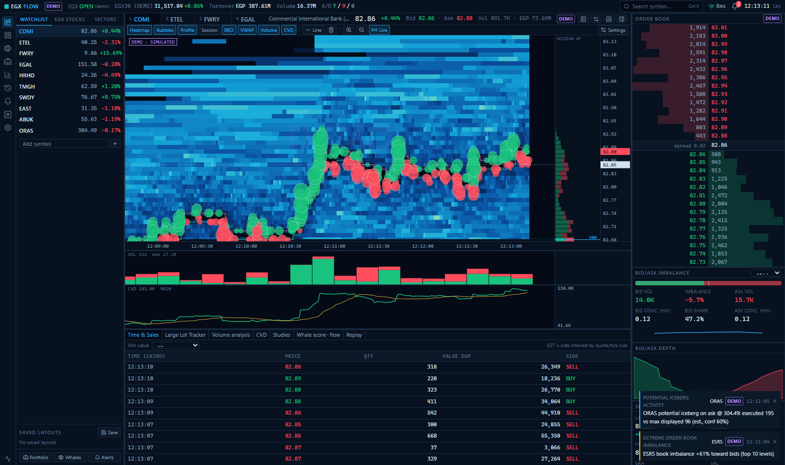
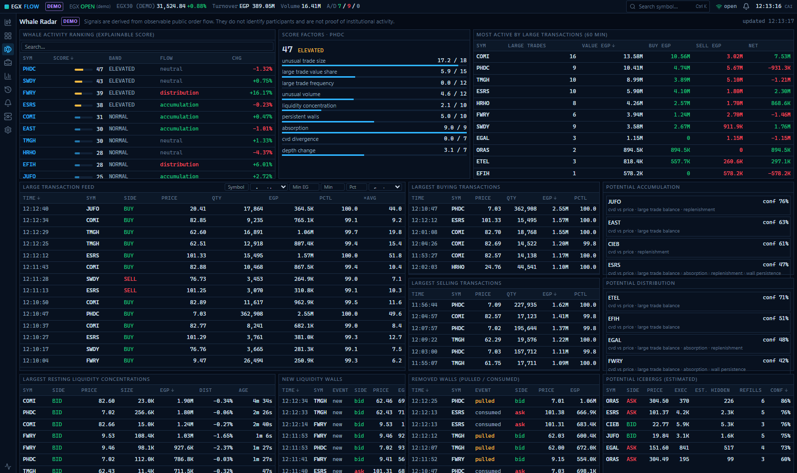
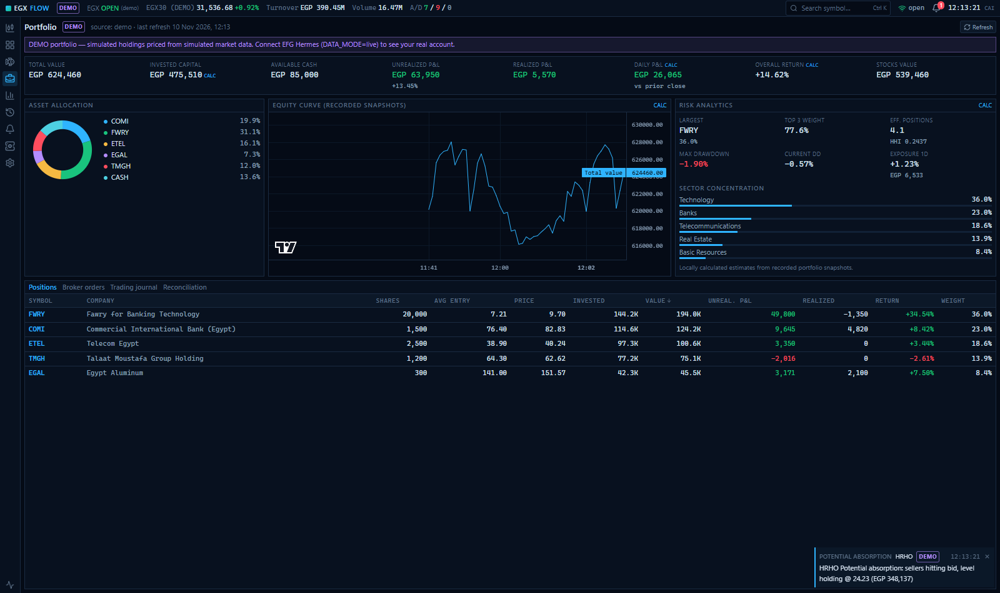

# EGX Flow

**A read-only order-flow and market-intelligence terminal for the Egyptian Exchange (EGX).**

Liquidity heatmap, aggressor volume bubbles, volume profile, CVD, order-book imbalance, a
Large Lot Tracker, an explainable **Whale Radar**, portfolio analytics, alerts and session
replay — in one dense, keyboard-driven workstation. It runs out of the box on **simulated
demo data**, and can connect to an **EFG Hermes ONE** account through the official Younit SDK.

[](https://github.com/abdelrahmanhanyy2003-cmyk/egx-flow/actions/workflows/ci.yml)




| Whale Radar | Portfolio |
|---|---|
|  |  |

> All screenshots show **simulated demo data**, not real market activity.

## Try it in two minutes (demo mode)

You need **Python 3.11+** and **Node.js 20+**. No account, no credentials.

**Windows** — double-click **`Start EGX Flow.cmd`**
(or run `scripts\start.ps1`). Stop it with **`Stop EGX Flow.cmd`**.

**macOS / Linux**

```bash
./scripts/start.sh        # Ctrl+C stops it
```

The first run sets everything up (a few minutes); later starts take under a minute. The app
opens at <http://localhost:3100>. It pre-generates 20 minutes of simulated EGX order flow so
every screen is populated, and labels everything **DEMO**.

The launcher only listens on `127.0.0.1` — nothing is reachable from other devices.

<details>
<summary>Manual start (for development)</summary>

```bash
# backend
cd backend
python -m venv .venv
.venv/Scripts/python -m pip install -r requirements-dev.txt     # macOS/Linux: .venv/bin/python
.venv/Scripts/python -m uvicorn app.main:app --port 8000

# frontend (second terminal)
cd frontend
npm install
npm run dev            # http://localhost:3000
```

Docker (PostgreSQL + TimescaleDB + Redis): `cp .env.example .env && docker compose up --build`
</details>

## What's inside

| Screen | Highlights |
|---|---|
| **Terminal** | Canvas heatmap of resting liquidity over time, best bid/ask, VWAP, aggressor bubbles (filled = side reported by the feed, hollow = side estimated), session/visible volume profile with POC/VAH/VAL, volume bars, CVD with moving average, order-book ladder with wall/iceberg tags, imbalance at configurable depth, depth chart, Time & Sales, Large Lot Tracker, studies (RSI, MACD, ATR, RVOL, SMA, EMA). Resizable, collapsible, rearrangeable panels; saved layouts; drawing tool. |
| **Stock Explorer** | Sortable, searchable universe: change, volume, value, RVOL, spread, liquidity score, whale score; sector and liquidity filters |
| **Whale Radar** | Explainable 0–100 whale score, large-transaction feed with filters, largest buys/sells, liquidity walls (new / pulled / consumed), potential icebergs, potential accumulation/distribution |
| **Portfolio** | Value, cash, unrealized/realized/daily P&L, allocation, risk (concentration, sectors, drawdown), equity curve, broker orders, trading journal (FIFO, fees), broker↔journal reconciliation |
| **Position details** | Heatmap with your entry line, daily and intraday charts, profile, CVD, large trades, walls |
| **Market Overview** | Index, turnover, breadth, market map, movers, sectors |
| **Historical Replay** | Play, pause, speed and seek through recorded sessions — same analytics engine as live |
| **Alerts** | 14 rule types, global and per-symbol thresholds, sound, history without duplicates |
| **API Status** | Provider state, capability matrix, data-integrity counters |

Keyboard shortcuts: press `?` in the app, or see [docs/KEYBOARD_SHORTCUTS.md](docs/KEYBOARD_SHORTCUTS.md).

## Principles

* **Read-only.** EGX Flow never places, modifies or cancels orders. The broker SDK's trading
  methods are unreachable by design and by test.
* **Honest data.** Every value carries its source and quality (`LIVE`, `DELAYED`,
  `HISTORICAL`, `DEMO`). Estimated trade sides, heuristic icebergs and locally calculated
  portfolio fields are flagged. Nothing is fabricated, and order-book history is never
  reconstructed from candles.
* **Explainable signals.** The whale score and accumulation/distribution signals list the
  evidence behind them. They are indicators from public order flow — they do not identify
  participants and are not proof of institutional activity.

## Connect to EFG Hermes (live mode)

Live mode needs an EFG Hermes ONE account with API access (a trading ID and an API key).

1. Install the official SDK into the backend environment (its PyPI package is not published yet):
   ```bash
   backend/.venv/Scripts/python -m pip install "git+https://github.com/efg-hermes-younit/younit-python@master"
   ```
2. In `.env` (created on first launch from `.env.example`) set:
   ```
   TRADING_ID=...
   API_KEY=...
   DATA_MODE=live
   ```
3. Restart. **API Status** shows sign-in, streaming state and whether your feed is live or delayed.

What the SDK provides — and what it does not — is documented in
[docs/EFG_API_CAPABILITIES.md](docs/EFG_API_CAPABILITIES.md). In short:

* It provides **Level 1** quotes (best bid/ask and sizes), the **trade tape**, market and
  index statistics, daily candles, portfolio, positions, cash and orders.
* It has **no Level 2 depth**, so the live heatmap shows best bid/ask liquidity only and is
  labelled `L1 ONLY`. A licensed depth feed can be plugged into the provider interface.
* Trade aggressor side is **estimated** (quote/tick rule) until the meaning of the feed's
  side field is confirmed with EFG Hermes.

Live mode was built against the SDK's source and tested with mocks; it has **not yet been run
against a real account**.

## Security

* Listens on `127.0.0.1` only; CORS allow-list for REST, `Origin` check for the WebSocket,
  `Host` allow-list, per-IP rate limits, connection caps, strict Content-Security-Policy.
* Credentials live only in the backend `.env` (git-ignored); they are never sent to the
  browser, returned by the API or written to logs.
* **Hosting a public demo?** Set `PUBLIC_DEMO=true`: simulated data only (the app refuses to
  start in live mode), every write endpoint disabled, API docs hidden.

Details and vulnerability reporting: [SECURITY.md](SECURITY.md).

## Tests

```bash
cd backend && .venv/Scripts/python -m pytest      # 95 tests; 2 live broker checks are opt-in
cd frontend && npm test && npm run typecheck
```

They cover the calculations (CVD, profile, POC/value area, imbalance, large-lot thresholds,
whale score, iceberg and absorption heuristics, indicators, P&L), replay matching live
results, de-duplication, reconnection, late and missing events, and the security guards.

## Documentation

[Architecture](docs/ARCHITECTURE.md) ·
[EFG Hermes capability matrix](docs/EFG_API_CAPABILITIES.md) ·
[Development](docs/DEVELOPMENT.md) ·
[Deployment](docs/DEPLOYMENT.md) ·
[Performance](docs/PERFORMANCE.md) ·
[Roadmap](docs/ROADMAP.md) ·
[Contributing](CONTRIBUTING.md)

## Disclaimer

EGX Flow is an independent open-source project. It is **not affiliated with, endorsed by or
sponsored by** the Egyptian Exchange, EFG Hermes, or any other company whose products are
mentioned; all trademarks belong to their owners. Demo mode uses real EGX ticker symbols and
company names for familiarity, but every price, size and trade in it is simulated.

Nothing here is investment advice. Use it at your own risk; see the [MIT License](LICENSE).
