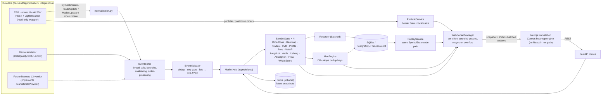

# EGX Flow — Technical architecture

EGX Flow is a **modular monolith**: one FastAPI process owns the market-data engine,
analytics, persistence and the WebSocket fan-out; a Next.js client renders the
workstation. Everything that touches a data source goes through a provider interface, so a
licensed Level 2 vendor can be added without changing analytics, storage or UI.

## Data flow

## Backend layout (`backend/app`)

| Package | Responsibility |
|---|---|
| `core/` | settings (`config.py`, SecretStr credentials), JSON logging with secret redaction, API token guard, time utils (UTC ms internally, Africa/Cairo display) |
| `domain/models.py` | normalized models: `Instrument`, `Quote`, `Trade`, `OrderBookLevel`, `BookSnapshot`, `BookDelta`, `MarketStats`, `IndexValue`, `PortfolioPosition`, `PortfolioSummaryData`, `BrokerOrder`; enums `DataQuality`, `ClassificationMethod`, `BookResolution` |
| `providers/base.py` | `MarketDataProvider`, `PortfolioProvider`, `ProviderCapabilities` (what the source *really* delivers) |
| `providers/demo/` | DEMO order-flow simulator and demo portfolio |
| `integrations/efg_hermes/` | `authentication.py` (SDK construction), `client.py` (read-only facade), `normalization.py`, `streaming.py` (adapter + `ConnectionMonitor`), `market_data.py`, `portfolio.py`, `rate_limit.py` |
| `market_data/` | `event_processor.py` (buffer/validator), `orderbook_engine.py`, `trade_classifier.py`, `heatmap.py`, `session_manager.py`, `normalizer.py` (tick-size resolver), `symbol_state.py` |
| `analytics/` | `cvd.py`, `volume_profile.py`, `imbalance.py`, `large_lot.py`, `liquidity_walls.py`, `iceberg.py`, `absorption.py`, `accumulation.py`, `whale_score.py`, `vwap.py`, `indicators.py`, `bars.py` |
| `portfolio/` | `pnl.py` (FIFO with fees), `positions.py` (broker vs local labelling), `reconciliation.py`, `risk.py` |
| `alerts/` | `rules.py` catalogue, `engine.py` |
| `replay/` | `recorder.py`, `playback.py` |
| `database/` | engine/session, ORM tables, repositories, Alembic migrations (`0001_initial` creates tables and TimescaleDB hypertables on PostgreSQL) |
| `services/` | `market_service.py` (MarketHub), `portfolio_service.py`, `replay_service.py`, `websocket_manager.py`, `cache.py` (Redis), `container.py` (composition root) |
| `api/routes/` | `auth, market, stocks, orderbook, trades, portfolio, positions, whales, alerts, replay, prefs` |

### Threading model
* Provider callbacks (Lightstreamer thread, demo task) call `EventBuffer.put` only.
* All `SymbolState` mutation happens on the asyncio loop thread; API handlers are `async`
  and read state on the same thread, so no locks are needed.
* Blocking work (SDK REST calls, DB writes) runs in worker threads (`asyncio.to_thread`).

### Backpressure
* `EventBuffer` coalesces quotes / book snapshots / stats per key (latest wins, order vs
  trades preserved) and never coalesces trades or deltas; overflow drops the oldest event,
  counts it and flags the symbol with a **gap** (shown on the Status page).
* `WebSocketManager` keeps a bounded queue per client; a slow client's backlog is dropped and
  it receives a fresh snapshot instead.

### Data-quality guarantees
* Every event and stored row carries `source`, `quality` (`live | delayed | historical |
  simulated`), original event `ts` and `received_ts`.
* Trade side carries `method` (`provider | quote_rule | tick_rule | unknown`) and
  `confidence`; unknown sides are excluded from CVD and counted separately.
* Order-book `resolution` (`order_events | depth_updates | depth_snapshots | l1_only`) is
  propagated to the UI, replay sessions and iceberg confidence.
* Tick size source is `provider | config | demo-config | inferred | unknown`.

## WebSocket protocol (`/ws`)

Client → server: `{"op":"sub","topic":"symbol:COMI"}`, `{"op":"unsub",...}`, `{"op":"ping","ts":...}`.
Topics: `symbol:<SYM>`, `market`, `whales`, `replay:<id>`.

Server → client:
* `{"type":"snapshot","topic":...,"data":{columns,trades,cvd,bars,book,profile,walls,icebergs,large_trades,flow,whale,stats,instrument}}`
* `{"type":"update","topic":...,"data":{columns,trades,cvd,events,stats,book,(profile,bar,walls,icebergs,whale,flow every ~1s)}}`
* `{"type":"market"|"whales"|"alert"|"status"|"pong", ...}`

Compact wire formats: heat column `[t, bestBid, bestAsk, last, prices[], qtys[]]`
(qty > 0 bid, < 0 ask); trade `[id, ts, price, qty, 'b'|'s'|'u', method, confidence]`.

## Database schema

| Table | Key | Notes |
|---|---|---|
| `instruments` | symbol | tick size + source |
| `market_sessions` | id; unique (date, symbol, source) | recorded sessions for replay incl. book resolution & interval |
| `quotes` | (symbol, ts, received_ts) | sampled L1; hypertable on PG |
| `trades` | (symbol, ts, trade_id) | every accepted trade; side method/confidence; hypertable |
| `orderbook_snapshots` | (symbol, ts) | top-N levels JSON at `BOOK_SNAPSHOT_RECORD_S`; hypertable |
| `orderbook_updates` | (symbol, ts, n) | incremental levels when a provider supplies them; hypertable |
| `volume_profiles` | unique (symbol, date, source) | session profile, POC, VA |
| `indicator_values` | (symbol, name, ts) idx | whale score, VWAP history |
| `portfolio_snapshots`, `portfolio_positions` | id | equity curve / drawdown (local) |
| `journal_entries` | id; unique broker_order_id | no double counting |
| `whale_events`, `liquidity_events` | id; (symbol, ts) idx | large trades, icebergs, absorption, flow, walls |
| `alerts` | id; unique dedup_key | alert history |
| `alert_rules` | unique (rule, symbol) | global + per-symbol thresholds |
| `watchlists`, `user_preferences` | | layouts, settings |

Time-series tables use composite primary keys that include `ts` (epoch ms) so they can be
TimescaleDB hypertables (`chunk_time_interval` = 1 day). Queries always filter by
`(symbol, ts)`; nothing loads full histories into memory (in-memory state is bounded by
`HEATMAP_HISTORY_COLUMNS` and `TRADE_HISTORY_LIMIT`).

## Frontend layout (`frontend/src`)

| Path | Responsibility |
|---|---|
| `lib/ws.ts` | single multiplexed WebSocket, auto-reconnect, topic re-subscription, latency ping |
| `lib/series.ts` | mutable per-topic store (struct-of-arrays trades, typed-array columns) read by the canvas each frame |
| `components/terminal/engine/HeatmapEngine.ts` | canvas renderer: incremental heatmap texture, bubbles, BBO, VWAP, profile, axes, volume & CVD panes, interaction |
| `components/terminal/*` | order book, imbalance, depth, tape, large-lot tracker, studies, flow panels |
| `store/ui.ts` | Zustand UI state (persisted): tabs, layout, heatmap/bubble settings, drawings |
| `app/*` | screens: Terminal, Explorer, Whale Radar, Portfolio, Position Details, Market, Replay, Alerts, Settings, Status |
